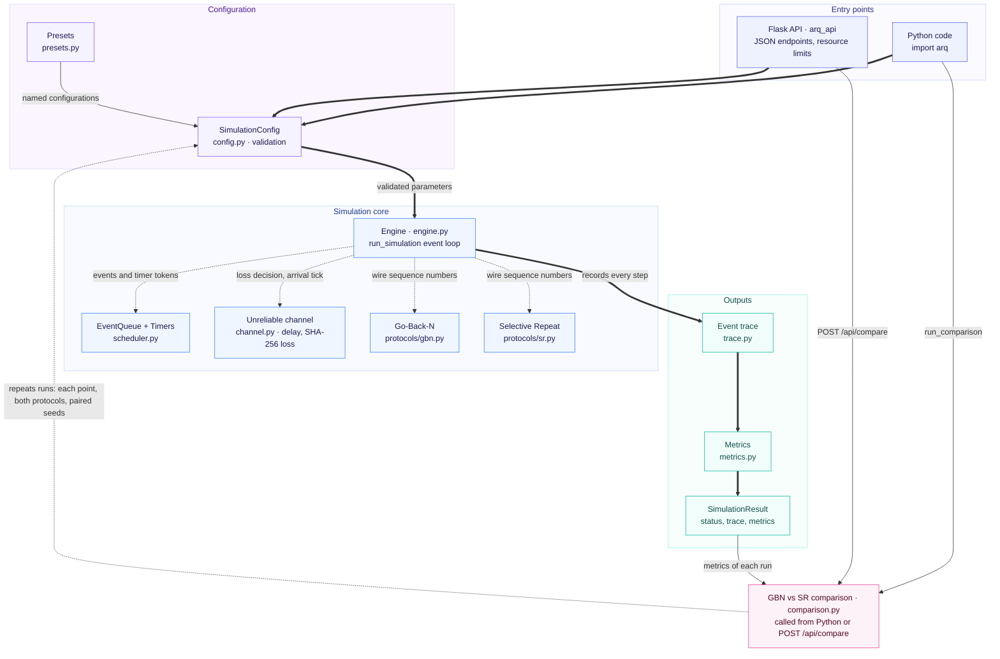
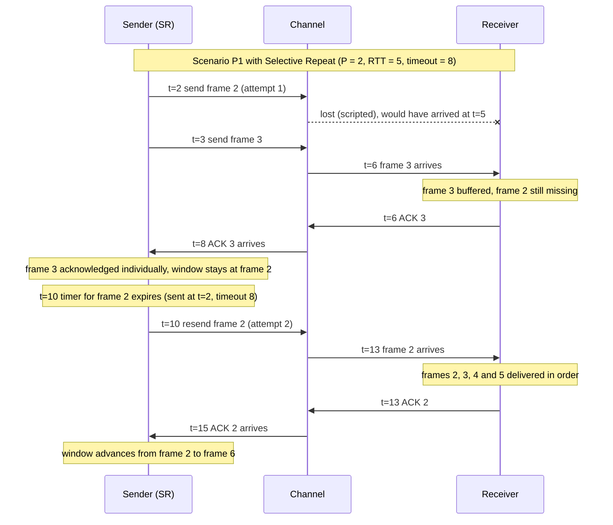

<h1 align="center">ARQ Protocol Simulator</h1>

<p align="center">
  <strong>A deterministic, event-driven simulator for the Go-Back-N and Selective Repeat ARQ protocols.</strong>
</p>

<p align="center">
  
  
  
  
</p>

<p align="center">
  Python simulation engine · Flask JSON API · reproducible event traces · GBN vs SR comparison
</p>

ARQ Protocol Simulator models how a sender and receiver keep a data transfer
reliable over a link that loses frames and acknowledgements. It implements
**Go-Back-N** and **Selective Repeat** with sliding windows, wrapping sequence
numbers, retransmission timers and per-frame retry limits. Every send, loss,
timeout, acknowledgement and delivery is recorded tick by tick, so you can see
exactly why a protocol retransmits, stalls, completes or gives up.

Every run is fully deterministic:
- loss decisions are derived with SHA-256 from the seed;
- events follow a fixed priority order;
- stale timers are invalidated with generation tokens.

The same configuration therefore always produces the same trace, which makes
protocol comparisons repeatable and the behaviour testable.

<p align="center">
  
</p>

<p align="center">
  <sub>Conceptual overview of the ARQ simulation workflow and supported protocols.</sub>
</p>

## Table of Contents

- [Features](#-features)
- [Go-Back-N vs Selective Repeat](#-go-back-n-vs-selective-repeat)
- [Architecture](#-architecture)
- [Technical Highlights](#-technical-highlights)
- [Getting Started](#-getting-started)
- [API Reference](#-api-reference)
- [Reference Scenarios](#-reference-scenarios)
- [Project Structure](#-project-structure)
- [Testing](#-testing)
- [Development Status and Roadmap](#-development-status-and-roadmap)
- [Author](#-author)

---

## ✨ Features

### Protocols

- **Go-Back-N:** cumulative ACKs, one timer for the oldest unacknowledged
  frame, and retransmission of every outstanding frame on timeout.
- **Selective Repeat:** individual ACKs, one timer per frame, buffering of
  out-of-order frames, and in-order delivery once a gap is filled.
- **Sliding windows over wrapping sequence numbers:** `seq_bits`-bit wire
  numbers, with each protocol's window limit enforced: M − 1 for GBN and M / 2
  for SR, where M = 2^seq_bits.
- **Per-frame retry limit:** a frame that exhausts its retransmissions fails
  the transfer.
- **No duplicate delivery and no fast retransmit.** Duplicate frames and ACKs
  are recognised and handled without side effects.

### Unreliable channel

- **Constant propagation delay:** a frame sent at tick `t` arrives at
  `t + 1 + P`, and its ACK returns `P` ticks later, so RTT = 1 + 2P.
- **Independent loss probabilities** for frames and for ACKs.
- **Scripted losses** that target an exact transmission, for example "lose
  the first transmission of frame 2" or "lose the ACK for frame 7".

### Results

- **Event trace:** 14 event types, from `transfer_started` to `completed`,
  `failed` or `aborted`. Each entry carries the processing step, the simulated
  tick, the acting component, a snapshot of the sender, receiver and timer
  state, and event-specific details.
- **Metrics:**
  - frame transmissions and retransmissions;
  - frame and ACK losses;
  - deliveries and duplicate counts;
  - valid and stale timeouts;
  - completion time and goodput.
- **Three outcomes:**
  - `completed`: the sender holds ACKs for every frame;
  - `failed_retry_limit`: a frame ran out of retransmissions;
  - `aborted_safety_limit`: an event-count safety limit was reached.

### Scenarios and comparison

- **Nine named presets:** reference scenarios P0–P6, a retry-exhaustion case
  and a random-loss run.
- **GBN vs SR sweeps:**
  - frame loss from 0.00 to 0.40, or window size from 1 to 8;
  - paired seeds, 50 runs per point by default;
  - completion rate, goodput, transmissions, retransmissions and completion
    time for each point.
- **Flask API:** exposes simulation, presets and comparison as JSON
  endpoints, with field-level validation and resource limits.

---

## 🔁 Go-Back-N vs Selective Repeat

| | Go-Back-N | Selective Repeat |
|---|---|---|
| Window limit | `window_size ≤ M − 1` | `window_size ≤ M / 2` |
| Receiver | Accepts only the next expected frame and discards the rest | Accepts any frame in its window and buffers out-of-order frames |
| ACKs | Cumulative; a discarded frame triggers a repeat of the last in-order ACK | Individual, one per frame; duplicates are re-acknowledged |
| Timers | One, for the oldest unacknowledged frame | One per outstanding frame |
| On timeout | Resends **every** outstanding frame | Resends **only** the expired frame |
| Cost of one lost frame | The lost frame and every frame sent after it | The lost frame only |

With one frame lost in an 8-frame transfer (scenario P1):
- **Go-Back-N:** 4 retransmissions, completing at tick 25.
- **Selective Repeat:** 1 retransmission, completing at tick 21.

---

## 🧱 Architecture

### System architecture



**How to read the diagram:**
- **Thick arrows** are the main execution path. A validated configuration
  drives one engine run, which produces a trace, metrics and a result.
- **Dashed arrows from the engine** are its collaborators:
  - the event queue and timers;
  - the channel, which decides loss and arrival time;
  - the protocol state machine selected for the run.

  The protocols receive only wire sequence numbers and return send and timer
  actions. They never see ticks, the queue or the channel.
- **The comparison layer** sits outside the engine. It is called from Python
  (`run_comparison`) or through `POST /api/compare`. It builds one
  configuration per sweep point, protocol and seed, runs the engine for each,
  and aggregates the resulting metrics.

The engine package (`arq`) depends only on the Python standard library. The
API package (`arq_api`) depends on `arq`, never the reverse.

### Simulation lifecycle

Each run is a loop over four kinds of scheduled event:
- **Transmission slot:** the sender begins one frame, and the channel decides
  whether that transmission is lost.
- **Frame arrival:** the receiver accepts, buffers or discards the frame and
  may send an ACK.
- **ACK arrival:** the sender advances its window, restarts or stops timers,
  and cancels retransmissions that are no longer needed.
- **Timeout:** a stale timeout is ignored. A valid one queues
  retransmissions, or fails the run if the frame has no retries left.

The diagram below is taken directly from the trace of scenario P1 under
Selective Repeat:



Under Go-Back-N, the same loss makes the receiver discard frames 3–5. After
the timeout at tick 14, the sender resends frames 2, 3, 4 and 5 at ticks
14–17.

---

## 🔬 Technical Highlights

- **Deterministic loss without a random stream.** Each loss decision hashes
  `seed:kind:frame:occurrence` with SHA-256 (never Python's built-in hash
  function). A transmission is lost if the first 64 bits, read as a fraction,
  fall below the loss probability. Each decision depends only on its own key,
  so results are identical across processes, and forcing one loss never
  changes any other loss.
- **Explicit event priority.** The queue orders events by
  `(time, priority, insertion order)`, with arrivals before timeouts before
  transmission slots at the same tick. An ACK arriving exactly at a deadline
  is therefore processed before the timeout.
- **Stale timer invalidation.** Every timer start or restart takes a new token
  from one global counter. A timeout whose token no longer matches is stale
  and is ignored: no retransmission, no retry counted.
- **Protocol separation.** GBN and SR are pure state machines behind a small
  sender/receiver interface. They make decisions from wire sequence numbers
  and window state alone. Absolute frame indices are kept for bookkeeping and
  reporting only, and a test checks that the protocols never read them.
- **Precise timer rules.**
  - Timers start when a transmission begins.
  - The GBN timer restarts when an ACK advances the window.
  - Queued retransmissions take priority over new frames.
- **Precise retry rules.** A frame lost on its last allowed attempt fails the
  run only when its next valid timeout fires.
- **Self-checking engine.** Impossible internal states raise
  `SimulationInvariantError` instead of producing a plausible-looking result.
  Examples are out-of-order delivery, a retry count above the limit, and an
  event scheduled in the past.
- **Compact, immutable trace.** Snapshots are stored as frozen tuples and
  shared between consecutive entries with identical state, so later
  processing can never alter an earlier entry.
- **Bounded API workload.** Requests are checked against worst-case
  transmission budgets before any simulation starts.

The behavioural rules behind the protocols, timers, loss model and trace are
summarised in [docs/SPEC.md](docs/SPEC.md).

---

## 🚀 Getting Started

### Prerequisites

- Python 3.10 or newer. This is the minimum declared in
  `backend/pyproject.toml`; the suite has been verified on Python 3.14.2 (see
  [Testing](#-testing)).
- Git

### 1. Clone and set up

```bash
git clone https://github.com/dhyeydaftary/arq-protocol-simulator.git
cd arq-protocol-simulator/backend
python -m venv .venv
# Windows (PowerShell):  .venv\Scripts\Activate.ps1
# macOS / Linux:         source .venv/bin/activate
python -m pip install "flask>=2.3" "pytest>=7"
```

The simulation engine has no third-party dependencies. Flask is needed only
for the API, and pytest only for the tests. These are the same requirements
as the `dev` optional dependencies in `backend/pyproject.toml`.

The project itself does not need to be installed as a package. Run every
command below from `backend/`: the packages are importable from there, and
pytest's configuration adds that directory to the import path.

### 2. Run the tests

```bash
python -m pytest
```

### 3. Run a simulation from Python

From `backend/`:

```python
from arq import SimulationConfig, run_simulation

config = SimulationConfig.from_dict({
    "protocol": "sr",
    "num_frames": 8,
    "frame_loss": 0.0,
    "ack_loss": 0.0,
    "scripted_losses": [{"kind": "frame", "index": 2, "occurrence": 1}],
})
result = run_simulation(config)

print(result.status, result.metrics.completion_tick, result.metrics.retransmissions)
# completed 21 1
for entry in result.trace[:4]:
    print(entry.step, entry.time, entry.type, dict(entry.details))
```

`run_simulation` returns a `SimulationResult`. `result.to_dict()` gives the
same JSON structure as `POST /api/simulate`, except that the API response also
includes the `config` and `warnings` fields.

### 4. Start the API

From `backend/`:

```bash
python -m arq_api
```

This starts Flask's development server on `http://127.0.0.1:5000`. If that
port is already in use, run `python -m flask --app arq_api run --port 5001`
and use that port in the requests below.

### 5. Send a request

```bash
curl -X POST http://127.0.0.1:5000/api/simulate \
     -H "Content-Type: application/json" \
     -d '{"protocol": "sr"}'
```

In Windows PowerShell:

```powershell
Invoke-RestMethod -Method Post -Uri http://127.0.0.1:5000/api/simulate `
    -ContentType "application/json" -Body '{"protocol": "sr"}'
```

With every other setting at its default (12 frames, 10% frame loss, 5% ACK
loss, seed 42), this run completes at tick 32 after 14 transmissions, 2 of
them retransmissions.

---

## 🔌 API Reference

| Method | Endpoint | Purpose |
|---|---|---|
| `POST` | `/api/simulate` | Run one simulation. The body is a configuration object; missing fields use their defaults |
| `GET` | `/api/presets` | List the nine presets, each with a complete configuration and, where defined, its expected results |
| `POST` | `/api/compare` | Run a GBN vs SR sweep: `{"sweep": "frame_loss" or "window_size", "runs"?, "base_seed"?, "config"?}` |

### Configuration

| Field | Default | Allowed | Meaning |
|---|---|---|---|
| `protocol` | `"gbn"` | `"gbn"`, `"sr"` | Go-Back-N or Selective Repeat |
| `seq_bits` | `3` | 1–16 | Sequence-number bits; M = 2^seq_bits |
| `window_size` | `4` | 1 to M − 1 (GBN), 1 to M / 2 (SR) | Maximum outstanding frames |
| `num_frames` | `12` | 1–100 | Frames to transfer |
| `propagation_delay` | `2` | 0–1000 | One-way delay P, in ticks |
| `timeout` | `8` | 1–100000 | Retransmission timeout, in ticks |
| `frame_loss` | `0.10` | 0.0–1.0 | Probability a frame transmission is lost |
| `ack_loss` | `0.05` | 0.0–1.0 | Probability an ACK is lost |
| `retry_limit` | `10` | 0–1000 | Retransmissions allowed per frame |
| `seed` | `42` | 0 to 2^63 − 1 | Seed for deterministic random loss |
| `scripted_losses` | `[]` | list | Forced losses, e.g. `{"kind": "ack", "index": 1, "occurrence": 1}` |

Invalid values are rejected with every problem listed. Misspelled field names
get a "did you mean" suggestion. Legal but doubtful settings, such as a
`timeout` shorter than the RTT, are accepted and reported in `warnings`.

### `POST /api/simulate`

```json
{"protocol": "gbn", "num_frames": 8, "frame_loss": 0, "ack_loss": 0,
 "scripted_losses": [{"kind": "frame", "index": 2, "occurrence": 1}]}
```

Response 200 (abridged):

```json
{
  "status": "completed",
  "end_tick": 25,
  "events_processed": 38,
  "failed_frame": null,
  "metrics": {"frame_transmissions": 12, "retransmissions": 4,
              "completion_tick": 25, "goodput": 0.32, "...": "..."},
  "trace": [{"event_id": null, "step": 0, "time": 0, "type": "transfer_started",
             "layer": "simulation", "actor": "simulator", "state": {}, "details": {}}],
  "config": {"protocol": "gbn", "...": "..."},
  "warnings": []
}
```

The `state` and `details` objects, and most of the trace, are shortened here.

Trace entries are ordered by `step`. `event_id` identifies the scheduled
event that caused an entry and is not a chronological order.

### `POST /api/compare`

Each response point carries GBN and SR aggregates:
- the number of runs, broken down by status;
- `completion_rate`;
- `mean_goodput_all` (runs that did not complete count as zero) and
  `mean_goodput_completed`;
- `mean_transmissions` and `mean_retransmissions`;
- `mean_completion_time`.

Run `r` uses seed `base_seed + r` for both protocols, so each pair of runs
faces the same loss decisions.

### Errors and limits

Errors are always JSON, and never include a server traceback:

```json
{"error": {"code": "invalid_config", "message": "Invalid simulation configuration",
           "issues": [{"field": "window_size", "message": "must be at least 1, got 0"}]}}
```

| Status | Code | When |
|---|---|---|
| 400 | `invalid_json` | Empty or malformed body |
| 400 | `invalid_config` / `invalid_request` | The configuration or comparison request is invalid (every problem listed) |
| 400 | `limit_exceeded` | The request is valid but exceeds a resource limit |
| 404 / 405 / 413 | `not_found` / `method_not_allowed` / `payload_too_large` | Unknown path, wrong method, or a body over 64 KB |
| 500 | `internal_error` | Unexpected server error (details are logged on the server only) |

The API caps the **worst-case** work a request can ask for. These are upper
bounds checked before anything runs, not predictions of actual traffic:

| Limit | Formula | Maximum |
|---|---|---|
| Per simulation | `num_frames * (1 + retry_limit)` | 2,500 transmissions |
| Per comparison | `points * 2 * runs * num_frames * (1 + retry_limit)` | 250,000 transmissions |
| Event backstop | — | 25,000 events per API simulation |

`points` is 9 for the frame-loss sweep and 8 for the window-size sweep. These
limits apply only to the HTTP API. Calling the engine from Python keeps its
default limit of 1,000,000 events.

---

## 📊 Reference Scenarios

The presets include seven reference scenarios whose results were calculated
by hand and are checked by the test suite.

Each scenario uses 8 frames, `seq_bits = 3`, window size 4, propagation delay
2 (RTT 5), timeout 8, retry limit 10 and no random loss, unless stated
otherwise. Results are transmissions / retransmissions / completion tick.

| Preset | Scenario | Go-Back-N | Selective Repeat |
|---|---|---|---|
| `no_loss` | P0: no loss | 8 / 0 / 13 | 8 / 0 / 13 |
| `frame_loss` | P1: frame 2 lost once | 12 / 4 / 25 | 9 / 1 / 21 |
| `ack_loss` | P2: ACK for frame 1 lost | 8 / 0 / 14 | 9 / 1 / 21 |
| `last_ack_loss` | P3: ACK for the last frame lost | 9 / 1 / 25 | 9 / 1 / 21 |
| `consecutive_frame_losses` | P4: frames 2, 3 and 4 lost once | 12 / 4 / 25 | 11 / 3 / 21 |
| `repeated_frame_loss` | P5: frame 2 lost twice | 16 / 8 / 33 | 10 / 2 / 29 |
| `premature_timeout` | P6: 4 frames, timeout 4 < RTT | 8 / 4 / 8 | 8 / 4 / 8 |

What the scenarios show:
- **P2:** a cumulative ACK lets Go-Back-N recover a lost ACK at no cost,
  while Selective Repeat must resend the frame.
- **P3:** every frame is delivered by tick 11, but the sender learns the
  transfer is complete only after a retransmission.
- **P6:** a timeout shorter than the RTT causes retransmissions with no loss
  at all, without ever delivering a frame twice.

---

## 📁 Project Structure

```text
arq-protocol-simulator/
├── backend/
│   ├── pyproject.toml        # package metadata, optional dependencies, pytest settings
│   ├── arq/                  # simulation engine (standard library only)
│   │   ├── config.py         # SimulationConfig: fields, validation, warnings
│   │   ├── events.py         # scheduled event kinds and priorities
│   │   ├── scheduler.py      # deterministic event queue and timers with generation tokens
│   │   ├── channel.py        # propagation delay, SHA-256 loss, scripted loss
│   │   ├── protocols/        # GBN and SR sender/receiver state machines
│   │   ├── engine.py         # run_simulation: event loop and outcomes
│   │   ├── trace.py          # trace entries and immutable state snapshots
│   │   ├── metrics.py        # metrics derived from the trace
│   │   ├── presets.py        # named scenarios, including P0–P6
│   │   ├── comparison.py     # GBN vs SR sweeps and aggregation
│   │   └── errors.py         # ConfigError, ComparisonError, SimulationInvariantError
│   ├── arq_api/              # Flask API (depends on arq; arq does not depend on it)
│   │   ├── __init__.py       # routes and JSON error handling
│   │   ├── __main__.py       # entry point for `python -m arq_api`
│   │   └── limits.py         # worst-case resource budgets
│   └── tests/                # pytest suite
└── docs/
    ├── SPEC.md               # behavioural specification
    └── images/
        └── arq-protocol-simulator-overview.svg   # README overview illustration
```

---

## 🧪 Testing

The pytest suite covers:
- configuration validation;
- event ordering and timers;
- the channel and its loss model;
- both protocol state machines on their own;
- engine integration, the trace, metrics and determinism;
- the reference scenarios and presets;
- comparison aggregation;
- the API's endpoints, errors and resource limits.

Determinism is checked across separate processes with different
`PYTHONHASHSEED` values.

```bash
cd backend
python -m pytest
```

**Latest verified run:** 605 passed, 0 failed, 0 skipped (Python 3.14.2,
pytest 9.2.0, Flask 3.1.3, Windows).

This records the result at the time of writing; rerun the suite after any
change. Other Python versions within the declared 3.10+ range have not been
tested. The API and resource-limit tests are skipped automatically if Flask
is not installed.

---

## 🚦 Development Status and Roadmap

| Area | Status |
|---|---|
| Simulation engine, channel, timers and event trace | ✅ Implemented |
| Go-Back-N and Selective Repeat | ✅ Implemented |
| Metrics, presets and GBN vs SR comparison | ✅ Implemented |
| Flask API with validation and resource limits | ✅ Implemented |
| Web frontend (React, TypeScript, Vite, Tailwind CSS) | 🔜 Planned |
| Interactive timeline of the event trace | 🔜 Planned |
| Charts for comparison results | 🔜 Planned |

The backend can be used today from Python or over the HTTP API. None of the
planned frontend features exists yet.

---

## 👤 Author

Developed by [@dhyeydaftary](https://github.com/dhyeydaftary).
